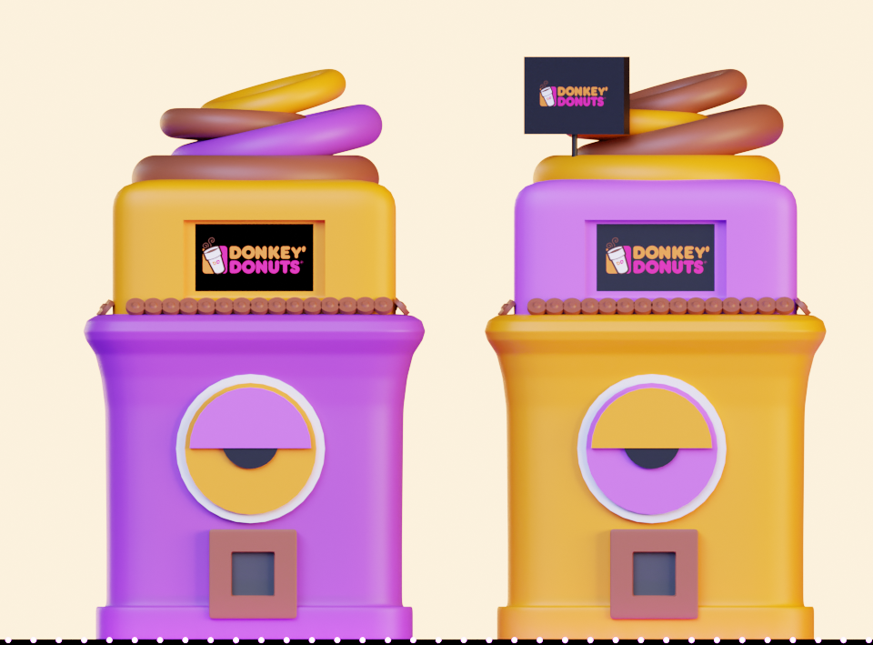
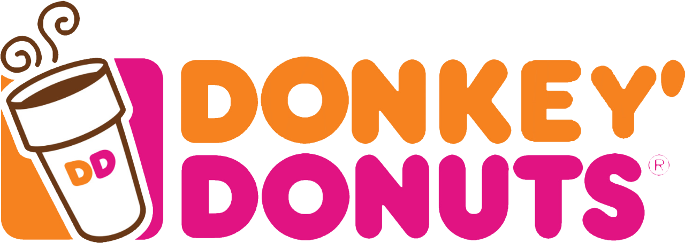

<div align="center">

# 🍩 Donkey' Donuts — Stylized 3D Vending Machine

**A stylized low-poly 3D scene created in Blender 5.2 LTS as part of a 3D modeling course.**


[](https://www.blender.org/)
[](https://creativecommons.org/licenses/by-nc/4.0/)
[](https://github.com/MelekBejaoui)

</div>

---

## 📖 Overview

This project is a **stylized, low-poly 3D scene** recreating two Dunkin' Donuts–inspired vending machines branded as **"Donkey' Donuts"**. The scene features a vibrant color palette of **purple, gold, and pink**, playful donut props on top, illuminated signage, a reflective surface, and a moody deep-blue background — all achieved entirely within Blender.

The project was built as the final deliverable of a Blender 3D modeling course, covering the full production pipeline from concept reference to final render.

---

## ✨ Features

- 🎨 **Stylized, cartoon-inspired aesthetic** with smooth, rounded forms
- 🍩 **Two vending machine variants** — one purple/gold, one gold/purple — with mirrored color schemes
- 💡 **Cinematic lighting** using area lights + HDRI for a neon-lit showroom feel
- 🪞 **Reflective floor** with subtle glossy material for a polished studio look
- 🪟 **Illuminated signage boards** with dot-light border effects on each billboard
- 🎯 **Reference-faithful modeling** — built from scratch against a reference image

---

## 🖼️ Gallery

| Final Render | Reference |
|:---:|:---:|
|  |  |

| Texture / Logo |
|:---:|
|  |

---

## 🛠️ Techniques Used

| Category | Details |
|---|---|
| **Modeling** | Mesh editing, proportional editing, sculpt-mode smoothing, edge loops |
| **Modifiers** | Array, Mirror, Bevel, Solidify, Subdivision Surface |
| **Shading / Materials** | Principled BSDF, emission shaders, glossy materials |
| **Texturing** | UV Unwrapping, image texture mapping (logo/signage) |
| **Lighting** | HDRI environment + area lights for rim and fill |
| **Rendering** | Cycles / EEVEE with denoising enabled |

---

## 📁 Project Structure

```
course Project/
├── Untitled.blend        # Main Blender project file
├── Untitled.blend1       # Auto-backup file
├── images/
│   ├── final render.png  # Final rendered output
│   ├── Reference.webp    # Reference image used during modeling
│   └── texture.webp      # Logo texture applied to signage
└── README.md             # This file
```

---

## 🚀 Getting Started

### Prerequisites

- [Blender 5.2 LTS](https://www.blender.org/download/) or later

### Opening the Project

1. Clone or download this repository.
2. Open Blender.
3. Go to **File → Open** and navigate to `Untitled.blend`.
4. The scene will load with all materials, lights, and camera settings intact.

> **Note:** If textures appear missing, relink them from the `images/` folder via **File → External Data → Find Missing Files**.

---

## 🎨 Render Settings

| Setting | Value |
|---|---|
| **Renderer** | Cycles / EEVEE |
| **Resolution** | 1920 × 1080 (Full HD) |
| **Samples** | 128+ (Cycles with denoising) |
| **Color Management** | Filmic, Medium Contrast |

---

## 👤 Author

**Melek Bejaoui**
- GitHub: [@MelekBejaoui](https://github.com/MelekBejaoui)

---

## 📄 License

This project is licensed under the **Creative Commons Attribution-NonCommercial 4.0 International** license.
You are free to share and adapt the work for non-commercial purposes, as long as appropriate credit is given.

See [LICENSE](https://creativecommons.org/licenses/by-nc/4.0/) for details.

---

<div align="center">

Made with ❤️ and Blender 🍩

</div>
